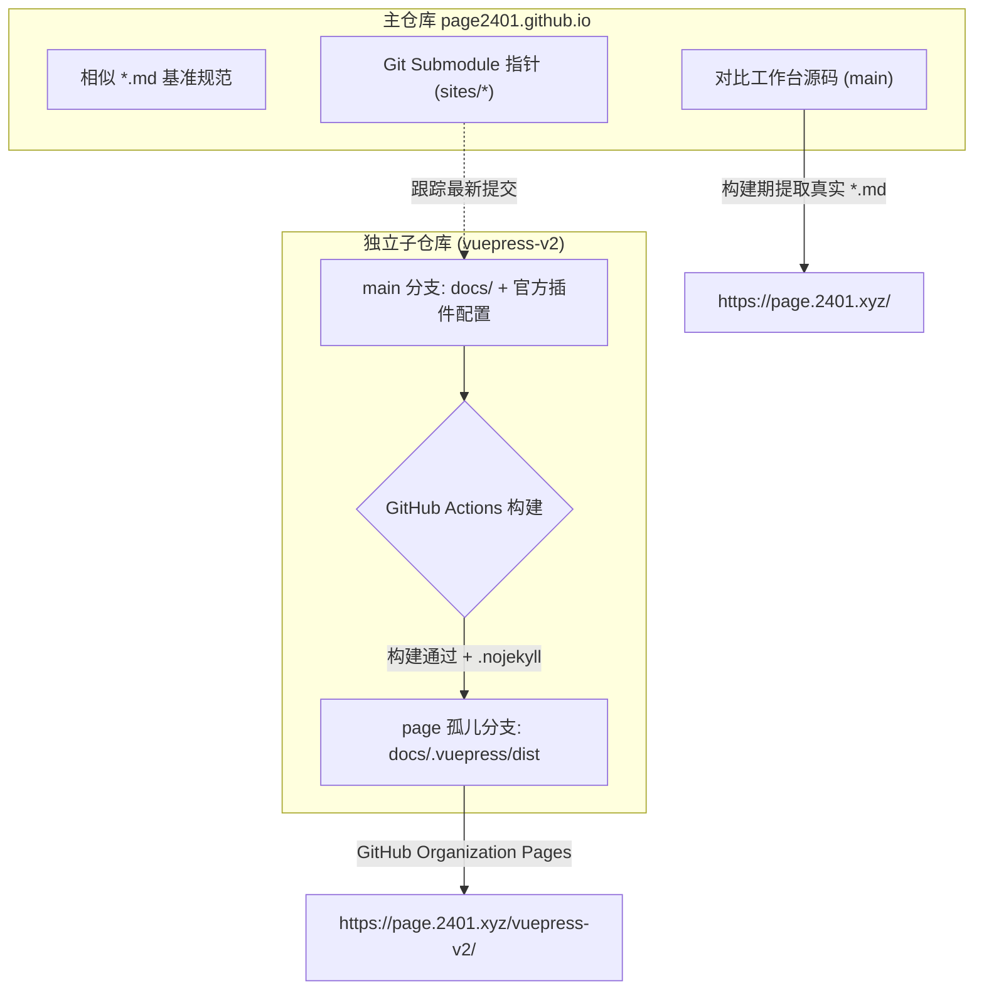
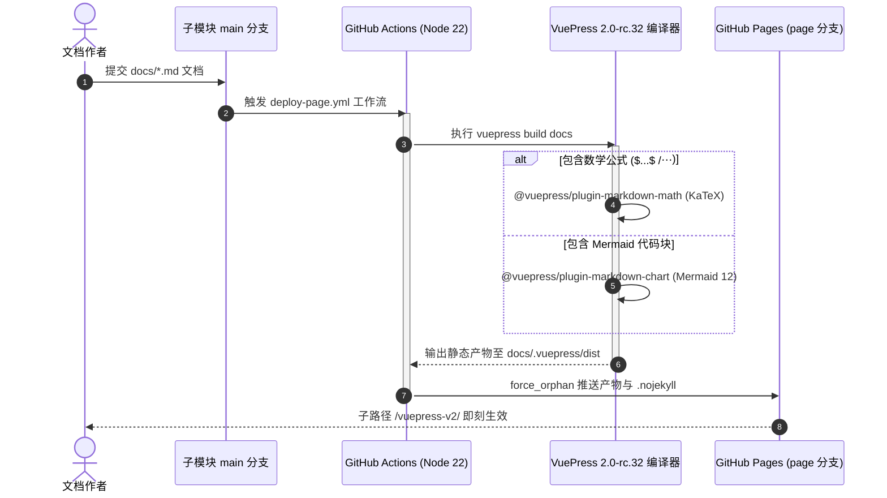
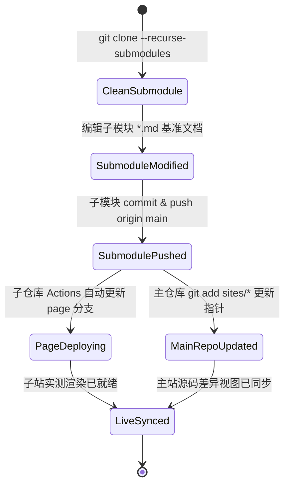

# 02. 流程图与时序图（Mermaid） <Badge type="tip" text="mermaid@12.3.0" vertical="middle" />

这是 VuePress v2 相比 VitePress 与 Astro Starlight 的一大工程亮点：**拥有官方维护的一等公民图表插件 `@vuepress/plugin-markdown-chart@2.0.0-rc.139`**！只需配置 `markdownChartPlugin({ mermaid: true })` 并安装 `mermaid@12.3.0`，即可开箱支持图表渲染与深浅色主题联动，无需自行编写 AST 插件或担心野生社区包断更。

## 1. 复杂子图与架构流程图（`flowchart TD`）

## 2. 编译管线交互时序图（`sequenceDiagram`）

## 3. 子模块同步状态机（`stateDiagram-v2`）

